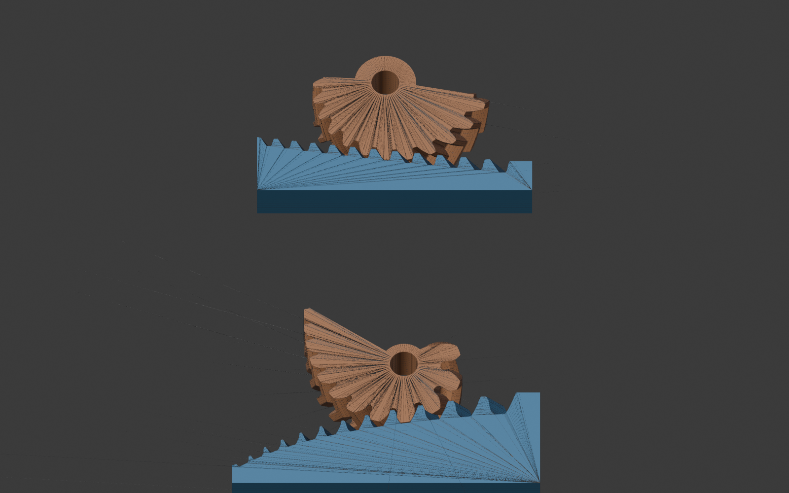
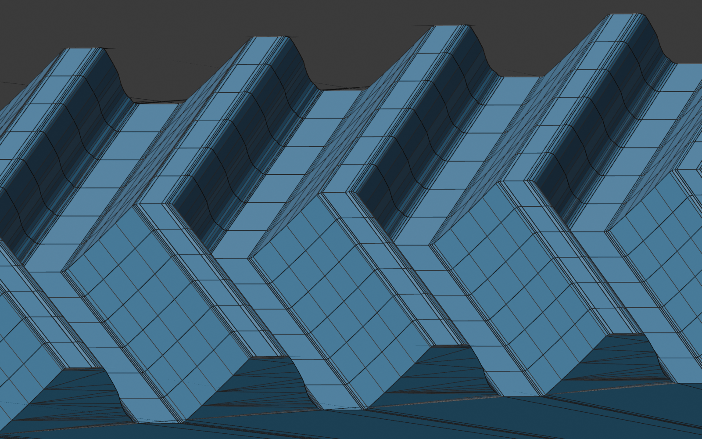

# Rack CT-CF

Blender add-on that generates a rack-and-pinion pair where the pinion has a
**variable radius** and the rack teeth change shape along the rack to match.
The teeth are chevron (herringbone) teeth. The parts are made for FDM printing
with a 0.4 mm nozzle.

## What it is for

A pinion with a constant radius passes the spring law straight through: the
force or the torque changes along the stroke. A pinion with a changing radius
evens it out.

- **CT, constant torque.** A spring pulls the rack, its force grows along the
  stroke. The pinion radius shrinks so that force x radius stays the same.
  Example: a motor that charges a spring sees a constant load.
- **CF, constant force.** A torsion spring sits on the pinion shaft, its torque
  grows as the rack is pushed in. The pinion radius grows (an Archimedean
  spiral) so that the force on the rack stays the same.

## How it works

1. The radius law follows from the force (or torque) at the start and at the
   end of the stroke and from the angle the pinion turns.
2. The pinion gets involute teeth. The rack is made by rolling the pinion
   through a blank, then the pinion is made again from that rack. The two
   surfaces fit each other, every tooth has its own shape.
3. The rack is rounded as if a circle of the nozzle diameter had rolled over
   it, so no corner is sharper than the printer can print. The tooth thickness
   and the flank angle are searched automatically.
4. Each layer of the face width is such a pair with the teeth shifted in
   phase. The second half of the width is the mirror image (chevron), so the
   axial forces cancel and some layer is always in contact.
5. The layers are lofted into closed solids with quads running along the
   teeth. Edges along the teeth are thinned greedily (the edge that changes
   the volume least goes first) within a tolerance.

## Install

- Blender 4.5 or newer (tested with 5.2 LTS). No extra Python packages.
- Edit > Preferences > Add-ons > Install from Disk, pick
  `ct_cf_chevron_rack.py`.
- 3D viewport > sidebar (N) > tab "Chevron rack" > Generate.
- 1 Blender unit = 1 mm. Export the two objects as STL.

## Main inputs

| Input | Meaning |
|---|---|
| Case | CT or CF |
| Gear radius at start, force at start | the start of the stroke |
| End / start ratio | force ratio (CT) or torque ratio (CF) |
| Gear usage angle | how far the pinion turns over the stroke |
| Nozzle | smallest corner radius is half of it |
| Helix angle, face width, layers | the chevron |
| Edge length | shortest mesh edge along the profile, default 0.05 mm |
| Mesh tolerance | allowed deviation of the thinned mesh, default 0.005 mm |
| Print clearance | gap put on the rack, the loaded flank keeps its shape |

The report under the button lists the stroke, the spring, the contact length,
the loss, the interference of the mesh and warnings.

## Status

- The geometry is checked numerically only: the meshes are closed and the
  overlap of the two parts is a few micrometres. No printed parts were tested
  yet.
- A default pair takes about 20 s (CF) to 35 s (CT) to build and has about
  10 000 to 17 000 triangles per part.
- Known weak points: the end faces are made of long thin triangles; at a
  30 degree helix and 10 mm face width each half shifts the teeth by less than
  one pitch (the add-on warns about it).

## Prior art

The idea of evening out a spring with a changing radius is old (snail cams,
fusee, variable radius pulleys). US 10,030,425 B2 (door closer, Yale Security)
describes the same radius law for constant torque with a cable on a cam, and
shows a pinion with a changing radius on an inclined rack with equal teeth as
one embodiment. This project does not claim that principle. It adds the
conjugate tooth shapes made by rolling, the CF case, the chevron and the
preparation for printing.
